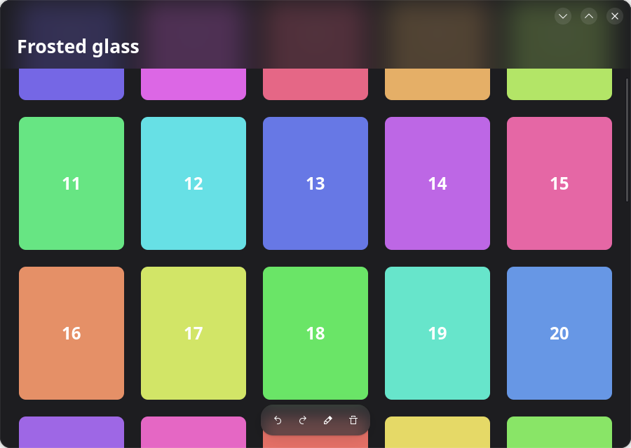

[English](README.md) · [简体中文](README.zh-CN.md) · [繁體中文](README.zh-TW.md) · **日本語**

# GTK 4 のすりガラス

ビューの上に浮かぶバーに、その下の内容をぼかして透かすためのものです。GTK 4 で書かれた GNOME
アプリ向けです。小さな Python ファイル [`glass.py`](glass.py) ひとつだけで、GTK 4 以外への
依存はありません。



もとは [Inkpad](https://github.com/LoveProgramming-cc/Inkpad-gnome) のコードで、Inkpad では
ページの上とライブラリの上のバーをこの方法で描いています。

## 試す

Python 3、PyGObject、GTK 4、libadwaita が必要です（libadwaita を使うのはデモだけで、
`glass.py` 自体は使いません）。Ubuntu や Debian では：

```sh
sudo apt install gir1.2-gtk-4.0 gir1.2-adw-1
python3 demo.py
```

グリッドをスクロールして、上部のバーの下にくぐらせてみてください。

## 使い方

`glass.py` をアプリにコピーします。`GlassOverlay` は `Gtk.Overlay` そのものです。バーを追加
するときに `add_overlay` の代わりに `add_glass` を使います：

```python
from glass import GlassOverlay

overlay = GlassOverlay(child=scrolled_view, backing='view_bg_color')
overlay.add_glass(pill, radius=18, blur=22)
```

```css
.pill {
  background: alpha(@popover_bg_color, 0.72);   /* ぼかしの上に重ねる色 */
  border-radius: 18px;                          /* add_glass に渡す半径と同じ値 */
}
```

| 引数 | 意味 |
|---|---|
| `radius` | バーの角の半径。CSS の値と同じにする必要があります。 |
| `blur` | ぼかしが広がる範囲。小さなピルなら 22 前後、幅の広いバーなら 38 前後。 |
| `on_height` | バーの高さが変わったときに、その高さを引数として呼ばれます。下の問題 4 を参照。 |
| `backing`（overlay 側） | ガラスの下のビューを塗っているテーマカラー。問題 2 を参照。 |

## これは必要ですか？ GTK 4.22 には `backdrop-filter` があります

**アプリが GTK 4.22 以降を必須にできるなら、`glass.py` は要りません。** GTK 4.22
（2026 年 3 月。開発版では 4.21.2 から）以降、GTK の CSS は `backdrop-filter` に対応して
おり、1 行で同じことができます：

```css
.pill {
  background: alpha(@popover_bg_color, 0.72);
  backdrop-filter: blur(11px);
  border-radius: 18px;
}
```

`python3 demo.py --native` は、ふつうの `Gtk.Overlay` を使ってデモをこの方法で動かします。
GTK 4.22 では両者の見た目は同じです。（GTK 4.22 と libadwaita 1.9 に `BlurOverlay` という
ウィジェットはありません。標準の方法はこの CSS プロパティです。）

`GlassOverlay` は、このプロパティを知らない古い GTK 4 でも動かす必要があるアプリのための
ものです。Ubuntu 24.04 は GTK 4.14、Debian 13 は 4.18、GNOME 49 は 4.20 です。

| | CSS `backdrop-filter` | `GlassOverlay`（このリポジトリ） |
|---|---|---|
| 必要なもの | GTK 4.22 以降 | GTK 4（4.0 からある API だけを使用。確認は 4.22 のみ） |
| コード | CSS 1 行 | 約 90 行の Python クラスをアプリにコピー |
| 使える場所 | どのウィジェットでも | `add_glass` で overlay に追加したウィジェットだけ |
| ぼかす対象 | そのウィジェットの背後に描かれたものすべて | overlay のメインの子だけ。他のバーは含まない |
| 角の半径 | `border-radius` に従う | CSS と `add_glass` の 2 か所に書く |
| ガラスの下のビューを不透明にする（問題 1） | デモでは不要 | 必要 |
| 端の外側の色（問題 2） | 不要 | `backing=` |
| 上部のバーの下に内容を入れる（問題 4） | 自分で配置する | 自分で配置する。`on_height=` が助けになる |
| ぼかしの数値 | `blur(N px)`：N は標準偏差 | `blur=R`：CSS の `blur(R/2)` と同じ広がり |
| 他の言語 | どの言語でも（CSS なので） | Python。同じ呼び出しは C、Rust、Vala、JavaScript にもある |

数値について：GTK 4.22 で測ると、CSS の `blur(20px)` は鮮明な境界を 48 px の幅に広げ、
ここでの `blur=22` は 26 px に広げます。したがって CSS の `blur(11px)` は `blur=22` に、
`blur(19px)` は `blur=38` に相当します。

実行時に選ぶこともできます。`Gtk.get_minor_version() >= 22` なら CSS を使い、そうでなければ
`GlassOverlay` を使います。

## これは何で、何ではないか

「すりガラス」と呼ばれるものは 2 種類あります：

| | ぼかす対象 | 描くのは | 使える環境 |
|---|---|---|---|
| **アプリ内のガラス**（このリポジトリ） | バーの下にあるアプリ自身の内容 | アプリ自身（GTK で） | GNOME、KDE など、どのデスクトップでも |
| **ウィンドウのガラス** | アプリの背後のデスクトップや他のウィンドウ | コンポジタ | ぼかし用プロトコルを持つコンポジタ（KWin）のみ。GNOME Shell では不可 |

GTK 4.22 より前の GTK の CSS には `backdrop-filter` がないため、半透明の背景だけでは透ける
バーになるだけで、
すりガラスにはなりません。ぼかしは自分で描く必要があります。GTK のシーングラフ（GSK）には
ぼかしノードがあり、必要なのはそれだけです。

## しくみ

ビューの上に浮かぶバーは `Gtk.Overlay` の子です。Overlay はまずメインの子を描き、その上に
各バーを描きます。バーをすりガラスにするには、overlay がそのバーを描く直前に、メインの子を
もう一度、ぼかしてバーの形に切り抜いて描きます：

1. メインの子を描画ノードとして一度だけ記録する。
2. そのノードを描く。
3. バーごとに：バーの角丸矩形でクリップし、ぼかしを push して、同じノードをもう一度描く。
4. バー自体を描く。CSS の背景が半透明なので、ぼかしに色が重なる。

ノードは一度だけ記録して使い回すので、ビューのレイアウトやラスタライズが二重になることは
ありません。GPU がぼかすのは各バーの下の小さな領域だけです。中心となるコード：

```python
def do_snapshot(self, snap):
    main = self.get_child()
    under = Gtk.Snapshot.new()
    self.snapshot_child(main, under)
    node = under.to_node()
    snap.append_node(node)
    for bar in bars:
        snap.push_rounded_clip(shape_of(bar))
        snap.push_blur(22.0)
        snap.append_node(node)
        snap.pop()
        snap.pop()
        self.snapshot_child(bar, snap)
```

## うまくいかない 4 つの点

どれも Inkpad 版を書いているときに実際に起きたものです。`glass.py` と `demo.py` はすべてに
対処しています。問題 1〜3 は `GlassOverlay` に固有のもので、問題 4 は CSS の
`backdrop-filter` でも同じです。

### 1. ぼかした層に穴があり、平らな灰色の箱に見える

バーの下のビューの背景が透明な場合（色は親が塗っている場合）、記録されたノードには項目だけが
入り、項目の間には何もありません。それをぼかすと半透明のにじみになり、下の鮮明な絵が透けて
見えます。ぼかしを強くするほど悪化し、筋が出たり、絵の残像が見えたりします。

**対処：** ぼかされるビューを不透明にします。overlay のメインの子に背景を持たせます：

```css
.under { background: @view_bg_color; }
```

### 2. ビューの端の近くでガラスが薄れていく

ビューの端の外側には何もなく、ぼかしはその「何もない」部分を混ぜ込みます。ウィンドウの最上部
にあるバーは、上端に向かって暗く（または明るく）なっていきます。

**対処：** `GlassOverlay` に `backing='view_bg_color'` を渡します。ぼかしの内側で、ビューを
描く前に、バーより広い領域をその色で塗るので、ビューが端の外まで続いているように見えます。

### 3. バーに映る範囲より広くぼかしてしまう

ぼかしの内側でクリップしないと、バーごとにビュー全体をぼかすよう GTK に頼むことになります。
`glass.py` は、バーの範囲をぼかし半径の 2 倍だけ広げた領域でビューをクリップします。

強さについて：半径をそのまま大きくすれば済みます。GTK 4.22（Vulkan レンダラ）で測ると、
ぼかした白黒の境界の 10–90 % の幅は、半径に比例して広がります：

| 半径 | 境界の幅 |
|---|---|
| 10 | 12 px |
| 22 | 26 px |
| 44 | 52 px |
| 88 | 104 px |

### 4. 内容がバーの下に入り込めるようにする

下に何もないガラスは、ただのバーにしか見えません。縦方向のボックスの中で、スクロールする
リストの*上*に置かれたヘッダーの背後には、何も来ません。ヘッダーを overlay の中に入れて、
リストがその下をスクロールするようにします。そのうえで、リストの上マージンをバーの高さと
同じにして、最初の行がバーの下から始まるようにします：

```python
overlay.add_glass(bar, radius=0, blur=38,
                  on_height=lambda h: flow.set_margin_top(int(h) + 10))
```

高さは、バーの範囲がすでに分かっている overlay の snapshot の中で通知されます。描画中に
レイアウトを変えてはいけないので、コールバックはアイドルハンドラから実行されます。（Inkpad
では、Python で `Gtk.Box` のサブクラスの `do_size_allocate` をオーバーライドしても呼ばれ
なかったため、この方法にしています。）

## 数値の選び方

| | 浮かぶ小さなピル | スクロールするリストの上の幅広いバー |
|---|---|---|
| ぼかし半径 | 22 | 38 |
| 色 | ポップオーバーの色を 72 % | ビューの色を 74 % |
| 結果 | 内容は和らぐが、まだ見分けられる | 内容はやわらかな色のかたまりになる |

## 制限

- **ポップオーバーとメニューは不透明のままです。** 別のサーフェスなので、overlay はその背後を
  描けません。
- **角の半径は 2 か所に書きます。** CSS と `add_glass` です。GTK はウィジェットの計算済みの
  角の半径を Python に渡しません。
- **ガラスのバーひとつごとに、ぼかしが 1 回増えます。** 下のビューが再描画されるたびに
  行われます。GPU レンダラ（GL、Vulkan）では軽い処理です。Cairo のソフトウェアレンダラ
  （`GSK_RENDERER=cairo`）では、ぼかしは遅くなります。
- **`lookup_color` は GTK 4 で非推奨です。** 今のところ動作します。代わりの方法は、自分の
  パレットから色を渡すことです。
- **ウィンドウのガラス**（ウィンドウの背後のデスクトップをぼかすもの）は別物で、GNOME 上の
  GTK アプリでは使えません。
- GTK 4.22 と libadwaita 1.9 でのみ確認しています。

## スクリーンショットツールなしで確認する

ウィンドウはアプリの内側から PNG に描き出せます。スクリーンショットに許可が必要な Wayland
でも使えます。`python3 demo.py --png out.png` がこれを行います：

```python
snap = Gtk.Snapshot.new()
Gtk.WidgetPaintable.new(window).snapshot(snap, window.get_width(), window.get_height())
texture = window.get_renderer().render_texture(snap.to_node(), None)
texture.save_to_png('window.png')
```

先に内容をバーの下までスクロールしておいてください。背後に何もないガラスは判断できません。

## ライセンス

Copyright © 2026 Inkpad の作者。

[MIT ライセンス](LICENSE)で公開しています。著作権表示とライセンス表示を残すかぎり、自由
ソフトウェアでもプロプライエタリでも、どのプロジェクトでも使えます。

このコードのもとは [Inkpad](https://github.com/LoveProgramming-cc/Inkpad-gnome) です。Inkpad
全体は GNU GPL バージョン 3 またはそれ以降ですが、Inkpad のライセンスはすりガラスの部分
（`inkpad/glass.py`）を例外としており、作者はその部分をここで MIT ライセンスでも提供して
います。
