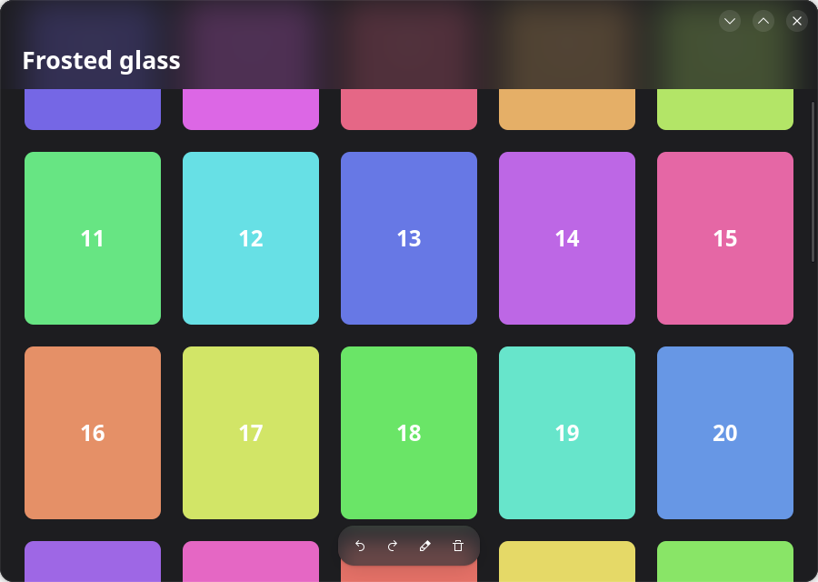

**English** · [简体中文](README.zh-CN.md) · [繁體中文](README.zh-TW.md) · [日本語](README.ja.md)

# Frosted glass for GTK 4

Bars that float over a view and show it blurred through them, for GNOME apps written with
GTK 4. One small Python file, [`glass.py`](glass.py), with no dependency beyond GTK 4.



It comes from [Inkpad](https://github.com/LoveProgramming-cc/Inkpad-gnome), where the bars
over the page and over the library are drawn this way.

## Try it

Needs Python 3, PyGObject, GTK 4 and libadwaita (the demo uses libadwaita; `glass.py` does
not). On Ubuntu or Debian:

```sh
sudo apt install gir1.2-gtk-4.0 gir1.2-adw-1
python3 demo.py
```

Scroll the grid under the bar at the top.

## Use it

Copy `glass.py` into your app. `GlassOverlay` is a `Gtk.Overlay`; add a bar with `add_glass`
instead of `add_overlay`:

```python
from glass import GlassOverlay

overlay = GlassOverlay(child=scrolled_view, backing='view_bg_color')
overlay.add_glass(pill, radius=18, blur=22)
```

```css
.pill {
  background: alpha(@popover_bg_color, 0.72);   /* the wash over the blur */
  border-radius: 18px;                          /* the same radius as in add_glass */
}
```

| Argument | Meaning |
|---|---|
| `radius` | The bar's corner radius. It has to be the one in its CSS. |
| `blur` | How far the blur spreads: about 22 for a small pill, about 38 for a wide bar. |
| `on_height` | Called with the bar's height when it changes; see problem 4 below. |
| `backing` (on the overlay) | The theme colour the view under the glass is filled with; see problem 2. |

## Do you need this? GTK 4.22 has `backdrop-filter`

**If your app can require GTK 4.22 or later, you do not need `glass.py`.** Since GTK 4.22
(March 2026; first in the development release 4.21.2), GTK's CSS supports `backdrop-filter`,
and one line does the same thing:

```css
.pill {
  background: alpha(@popover_bg_color, 0.72);
  backdrop-filter: blur(11px);
  border-radius: 18px;
}
```

`python3 demo.py --native` runs the demo that way, with a plain `Gtk.Overlay`; on GTK 4.22 the
two look the same. (There is no widget called `BlurOverlay` in GTK 4.22 or libadwaita 1.9;
the built-in way is this CSS property.)

`GlassOverlay` is for apps that also have to run on older GTK 4, where the property is not
known: Ubuntu 24.04 has GTK 4.14, Debian 13 has 4.18, GNOME 49 has 4.20.

| | CSS `backdrop-filter` | `GlassOverlay` (this repository) |
|---|---|---|
| Needs | GTK 4.22 or later | GTK 4; tested on 4.6 to 4.22, see [Tested versions](#tested-versions) |
| Code | one CSS line | a Python class of about 90 lines, copied into the app |
| Where it works | on any widget | only on widgets added to the overlay with `add_glass` |
| What is blurred | everything drawn behind the widget | only the overlay's main child, not other bars |
| Corner radius | follows `border-radius` | written twice, in the CSS and in `add_glass` |
| Opaque view under the glass (problem 1) | not needed in the demo | needed |
| Colour past the edge (problem 2) | not needed | `backing=` |
| Content under a top bar (problem 4) | still yours to arrange | still yours to arrange; `on_height=` helps |
| Blur number | `blur(N px)`: N is the standard deviation | `blur=R`: spreads like CSS `blur(R/2)` |
| Other languages | any (it is CSS) | Python; the same calls exist in C, Rust, Vala and JavaScript |

On the numbers: measured on GTK 4.22, CSS `blur(20px)` turns a sharp edge into a 48 px
transition, and `blur=22` here into 26 px. So CSS `blur(11px)` matches `blur=22`, and
`blur(19px)` matches `blur=38`.

An app can also choose at run time: use the CSS when
`Gtk.get_minor_version() >= 22`, and `GlassOverlay` otherwise.

## What it is, and what it is not

There are two things people call frosted glass:

| | Blurs | Who draws it | Works on |
|---|---|---|---|
| **In-app glass** (this repository) | the app's own content under a bar | the app, with GTK | GNOME, KDE, any desktop |
| **Window glass** | the desktop and other windows behind the app | the compositor | only compositors with a blur protocol (KWin); not GNOME Shell |

Before GTK 4.22, GTK's CSS has no `backdrop-filter`, so a translucent background alone only
gives a see-through bar, not a frosted one. The blur has to be drawn by hand. GTK's scene graph
(GSK) has a blur node, and that is all that is needed.

## How it works

A bar that floats over a view is a child of a `Gtk.Overlay`. The overlay draws its main child,
then each bar on top. To frost a bar, the overlay draws the main child a second time, blurred
and clipped to the bar's shape, just before it draws the bar:

1. Record the main child once as a render node.
2. Draw that node.
3. For each bar: clip to the bar's rounded rectangle, push a blur, draw the same node again.
4. Draw the bar itself. Its CSS background is translucent, so it tints the blur.

The node is recorded once and reused, so the view is not laid out or rasterised twice; the
GPU only blurs the small area under each bar. The core of it:

```python
def do_snapshot(self, snap):
    main = self.get_child()
    under = Gtk.Snapshot.new()
    self.snapshot_child(main, under)
    node = under.to_node()
    snap.append_node(node)
    for bar in bars:
        snap.push_rounded_clip(shape_of(bar))
        snap.push_blur(22.0)
        snap.append_node(node)
        snap.pop()
        snap.pop()
        self.snapshot_child(bar, snap)
```

## Four things that go wrong

These all happened while writing Inkpad's version. `glass.py` and `demo.py` handle each.
Problems 1 to 3 belong to `GlassOverlay`; problem 4 is the same with CSS `backdrop-filter`.

### 1. The blurred layer has holes, so it looks like a flat grey box

If the view under the bar has a transparent background (its colour is painted by a parent),
the recorded node contains only the items, with nothing between them. Blurred, that is a
half-transparent smear, and the sharp picture underneath shows through it. A stronger blur
makes it worse: it looks streaked, or shows a ghost of the picture.

**Fix:** make the blurred view opaque. Give the overlay's main child its own background:

```css
.under { background: @view_bg_color; }
```

### 2. The glass fades out near the edge of the view

Beyond the edge of the view there is nothing, and the blur mixes that nothing in. A bar at the
very top of a window turns dark (or light) towards its top edge.

**Fix:** pass `backing='view_bg_color'` to `GlassOverlay`. Inside the blur it paints that
colour over an area larger than the bar before drawing the view, so the view appears to
continue past its edge.

### 3. Blurring more than the bar can show

Without a clip inside the blur, GTK is asked to blur the whole view for every bar. `glass.py`
clips the view to the bar's bounds grown by twice the blur radius.

On strength: the radius can simply be raised. Measured on GTK 4.22 (Vulkan renderer), the
10–90 % width of a blurred black/white edge grows in step with it:

| Radius | Edge width |
|---|---|
| 10 | 12 px |
| 22 | 26 px |
| 44 | 52 px |
| 88 | 104 px |

### 4. Content has to be able to go under the bar

Glass over nothing looks like a plain bar. A header that sits *above* a scrolled list in a
vertical box never has anything behind it. Put the header in the overlay, so the list scrolls
underneath, and give the list a top margin equal to the bar's height so that its first row
starts below the bar:

```python
overlay.add_glass(bar, radius=0, blur=38,
                  on_height=lambda h: flow.set_margin_top(int(h) + 10))
```

The height is reported from the overlay's snapshot, where the bar's bounds are already known,
and the callback runs from an idle handler, because layout must not change while drawing.
(Overriding `do_size_allocate` on a `Gtk.Box` subclass in Python was not called in Inkpad,
which is why it is done this way.)

## Choosing the numbers

| | Small floating pill | Wide bar over a scrolling list |
|---|---|---|
| Blur radius | 22 | 38 |
| Tint | popover colour at 72 % | view colour at 74 % |
| Result | content stays recognisable, softened | content becomes soft patches of colour |

## Tested versions

`python3 test.py` draws a window with a sharp black/white edge under a glass bar and a glass
pill, and measures it: the edge has to be blurred under the glass and sharp beside it. It uses
GTK alone, without libadwaita. It passes on:

| GTK | From | Renderer | Result |
|---|---|---|---|
| 4.6.9 | Ubuntu 22.04 | GL | passes |
| 4.8.3 | Debian 12 | GL | passes |
| 4.14.5 | Ubuntu 24.04 | NGL | passes |
| 4.18.5 | Ubuntu archive | GL | passes |
| 4.20.1 | Ubuntu archive | Vulkan | passes |
| 4.22.4 | Ubuntu 26.04 | Vulkan | passes |

Each gave the same 26 px edge for `blur=22`. All of these except 4.22 reject
`backdrop-filter` in CSS ("No property named"), so `GlassOverlay` is the way to get frosted
glass there.

How it was tested: the GTK libraries of each version were taken from that distribution's
packages and loaded on one machine (Ubuntu 26.04, Wayland), with that machine's own GLib,
Pango, PyGObject and graphics driver. It was not run on the old distributions themselves, nor
on X11, nor with GTK older than 4.6. `demo.py` needs libadwaita and `load_from_string`
(GTK 4.12), and was run on 4.22 only.

## Limits

- **Popovers and menus stay opaque.** They are separate surfaces, so the overlay cannot
  draw what is behind them.
- **The corner radius is written twice,** in the CSS and in `add_glass`. GTK does not give a
  widget's computed border radius to Python.
- **Each glass bar is an extra blur** every time the view under it redraws. It is cheap on
  the GPU renderers (GL, Vulkan). With the Cairo software renderer (`GSK_RENDERER=cairo`)
  blur is slow.
- **`lookup_color` is deprecated** in GTK 4. It still works; the alternative is to pass the
  colour in from your own palette.
- **Window glass** (the desktop blurred behind the window) is a different thing and is not
  available to GTK apps on GNOME.

## Checking it without a screenshot tool

A window can be drawn to a PNG from inside the app, which also works on Wayland where
screenshots need permission. `python3 demo.py --png out.png` does this:

```python
snap = Gtk.Snapshot.new()
Gtk.WidgetPaintable.new(window).snapshot(snap, window.get_width(), window.get_height())
texture = window.get_renderer().render_texture(snap.to_node(), None)
texture.save_to_png('window.png')
```

Scroll some content under the bar first: glass with nothing behind it cannot be judged.

## Licence

Copyright © 2026 the Inkpad authors.

Released under the [MIT licence](LICENSE): use it in any project, free or proprietary, as long
as the copyright and licence notice stay with it.

The code comes from [Inkpad](https://github.com/LoveProgramming-cc/Inkpad-gnome), which as a
whole is under the GNU GPL, version 3 or later. Inkpad's licence makes an exception for its
frosted glass (`inkpad/glass.py`): its authors also offer that part under the MIT licence, here.
