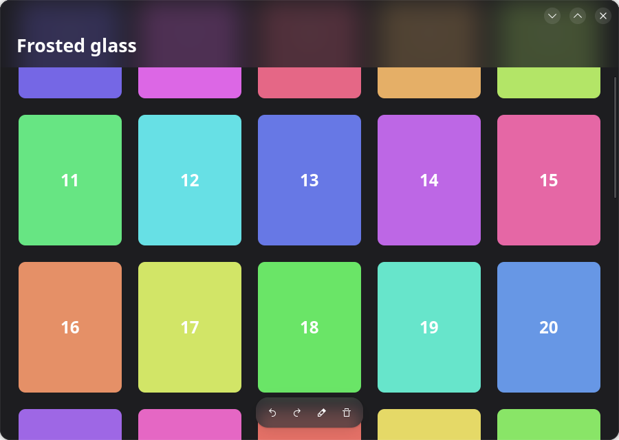

[English](README.md) · **简体中文** · [繁體中文](README.zh-TW.md) · [日本語](README.ja.md)

# GTK 4 的磨砂玻璃

让浮在视图上方的栏透出它下面模糊的内容，用于以 GTK 4 编写的 GNOME 应用。只有一个很小的
Python 文件 [`glass.py`](glass.py)，除 GTK 4 之外没有任何依赖。



它来自 [Inkpad](https://github.com/LoveProgramming-cc/Inkpad-gnome)，那里页面上方和文稿库
上方的栏就是这样画的。

## 试一试

需要 Python 3、PyGObject、GTK 4 和 libadwaita（演示程序用到 libadwaita，`glass.py` 本身
不用）。在 Ubuntu 或 Debian 上：

```sh
sudo apt install gir1.2-gtk-4.0 gir1.2-adw-1
python3 demo.py
```

把网格滚动到顶部的栏下面看看。

## 使用方法

把 `glass.py` 复制到你的应用里。`GlassOverlay` 就是一个 `Gtk.Overlay`；添加栏时用
`add_glass` 代替 `add_overlay`：

```python
from glass import GlassOverlay

overlay = GlassOverlay(child=scrolled_view, backing='view_bg_color')
overlay.add_glass(pill, radius=18, blur=22)
```

```css
.pill {
  background: alpha(@popover_bg_color, 0.72);   /* 盖在模糊之上的一层颜色 */
  border-radius: 18px;                          /* 与 add_glass 里的半径相同 */
}
```

| 参数 | 含义 |
|---|---|
| `radius` | 栏的圆角半径，必须与它 CSS 里的一致。 |
| `blur` | 模糊扩散的范围：小药丸约 22，宽的栏约 38。 |
| `on_height` | 栏的高度变化时被调用，参数是高度；见下面的问题 4。 |
| `backing`（在 overlay 上） | 玻璃下面的视图所填充的主题颜色；见问题 2。 |

## 它是什么，不是什么

人们说的“磨砂玻璃”有两种：

| | 模糊的是 | 由谁绘制 | 可用于 |
|---|---|---|---|
| **应用内的玻璃**（本仓库） | 栏下面应用自己的内容 | 应用自己，用 GTK | GNOME、KDE，任何桌面 |
| **窗口玻璃** | 应用背后的桌面和其他窗口 | 合成器 | 只有带模糊协议的合成器（KWin）；GNOME Shell 不行 |

GTK 的 CSS 没有 `backdrop-filter`，所以只用半透明背景得到的是一条透明的栏，而不是磨砂的
栏。模糊必须自己画。GTK 的场景图（GSK）有模糊节点，有它就够了。

## 原理

浮在视图上方的栏是 `Gtk.Overlay` 的子部件。Overlay 先画主子部件，再把每条栏画在上面。
要让一条栏变成磨砂的，overlay 在画这条栏之前，把主子部件再画一遍——模糊过，并裁剪成栏的
形状：

1. 把主子部件记录成一个渲染节点，只记录一次。
2. 画出这个节点。
3. 对每条栏：裁剪到栏的圆角矩形，压入模糊，再画一次同一个节点。
4. 画栏本身。它的 CSS 背景是半透明的，于是给模糊染上颜色。

节点只记录一次并重复使用，所以视图不会被布局或光栅化两次；GPU 只需模糊每条栏下面的一小块
区域。核心代码：

```python
def do_snapshot(self, snap):
    main = self.get_child()
    under = Gtk.Snapshot.new()
    self.snapshot_child(main, under)
    node = under.to_node()
    snap.append_node(node)
    for bar in bars:
        snap.push_rounded_clip(shape_of(bar))
        snap.push_blur(22.0)
        snap.append_node(node)
        snap.pop()
        snap.pop()
        self.snapshot_child(bar, snap)
```

## 四个会出问题的地方

这些都是在写 Inkpad 的版本时遇到的。`glass.py` 和 `demo.py` 已经逐一处理。

### 1. 被模糊的那一层有洞，看起来像一块平平的灰色

如果栏下面的视图背景是透明的（它的颜色由父部件来画），记录下来的节点里就只有各个项目，
项目之间什么都没有。模糊之后是一片半透明的涂抹，下面清晰的画面会透出来。模糊越强越糟：
看起来有条纹，或者显出画面的残影。

**解决办法：** 让被模糊的视图不透明。给 overlay 的主子部件一个自己的背景：

```css
.under { background: @view_bg_color; }
```

### 2. 玻璃在视图边缘附近逐渐消失

视图边缘之外什么都没有，模糊会把这个“什么都没有”混进来。紧贴窗口顶部的栏，越靠近上边缘
就越暗（或越亮）。

**解决办法：** 给 `GlassOverlay` 传入 `backing='view_bg_color'`。它会在模糊内部、画视图
之前，先用这个颜色涂满一块比栏更大的区域，于是视图看起来延伸到了边缘之外。

### 3. 模糊的范围超过了栏能显示的范围

如果模糊内部不加裁剪，每条栏都会让 GTK 去模糊整个视图。`glass.py` 把视图裁剪到栏的范围
向外扩大两倍模糊半径。

关于强度：直接把半径调大就行。在 GTK 4.22（Vulkan 渲染器）上测得，一条黑白边界被模糊后，
10–90 % 的过渡宽度与半径同步增长：

| 半径 | 边界宽度 |
|---|---|
| 10 | 12 px |
| 22 | 26 px |
| 44 | 52 px |
| 88 | 104 px |

### 4. 内容必须能滚到栏的下面

下面什么都没有的玻璃，看起来就是一条普通的栏。在竖直的盒子里，放在滚动列表*上方*的标题栏
背后永远没有东西。要把标题栏放进 overlay，让列表从它下面滚过；再给列表一个等于栏高度的
上边距，让第一行从栏的下方开始：

```python
overlay.add_glass(bar, radius=0, blur=38,
                  on_height=lambda h: flow.set_margin_top(int(h) + 10))
```

高度是在 overlay 的 snapshot 里报告的，那时栏的范围已经知道；回调在空闲处理函数里执行，
因为绘制过程中不能改变布局。（在 Inkpad 里，用 Python 重写 `Gtk.Box` 子类的
`do_size_allocate` 并没有被调用，所以才这样做。）

## 数值的选择

| | 浮动的小药丸 | 滚动列表上方的宽栏 |
|---|---|---|
| 模糊半径 | 22 | 38 |
| 染色 | 弹出层颜色，72 % | 视图颜色，74 % |
| 效果 | 内容柔化，但仍能辨认 | 内容变成柔和的色块 |

## 局限

- **弹出层和菜单仍然不透明。** 它们是单独的表面，overlay 画不到它们背后的内容。
- **圆角半径要写两次，** CSS 里一次，`add_glass` 里一次。GTK 不把部件计算后的圆角半径
  交给 Python。
- **每条玻璃栏都是一次额外的模糊，** 它下面的视图每重绘一次就做一次。在 GPU 渲染器
  （GL、Vulkan）上开销很小；用 Cairo 软件渲染器（`GSK_RENDERER=cairo`）时模糊很慢。
- **`lookup_color` 在 GTK 4 中已弃用。** 目前仍可用；替代办法是从你自己的调色板把颜色
  传进来。
- **窗口玻璃**（窗口背后的桌面被模糊）是另一回事，GNOME 上的 GTK 应用做不到。
- 只在 GTK 4.22 和 libadwaita 1.9 上测试过。

## 不用截图工具来检查

可以在应用内部把窗口画成 PNG，在截图需要授权的 Wayland 上也能用。
`python3 demo.py --png out.png` 做的就是这件事：

```python
snap = Gtk.Snapshot.new()
Gtk.WidgetPaintable.new(window).snapshot(snap, window.get_width(), window.get_height())
texture = window.get_renderer().render_texture(snap.to_node(), None)
texture.save_to_png('window.png')
```

先把一些内容滚到栏下面：背后没有东西的玻璃是没法判断效果的。

## 许可

版权所有 © 2026 Inkpad 作者。

自由软件，采用 [GNU 通用公共许可证第 3 版](LICENSE)或（由你选择）任何更新的版本，与这些
代码的来源 Inkpad 相同。
