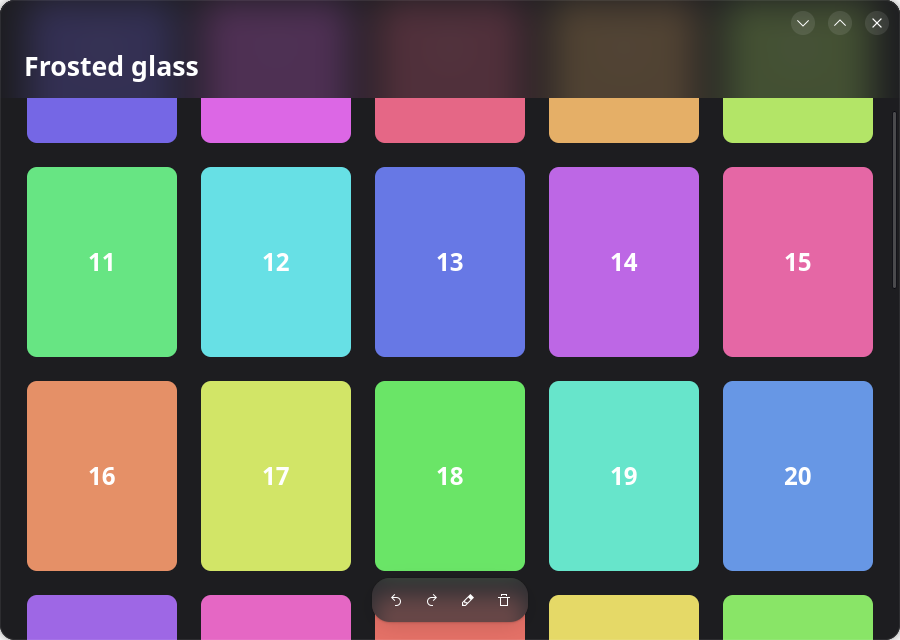

[English](README.md) · [简体中文](README.zh-CN.md) · **繁體中文** · [日本語](README.ja.md)

# GTK 4 的磨砂玻璃

讓浮在檢視上方的列透出它下面模糊的內容，用於以 GTK 4 撰寫的 GNOME 應用程式。只有一個很小的
Python 檔案 [`glass.py`](glass.py)，除了 GTK 4 之外沒有任何相依套件。



它來自 [Inkpad](https://github.com/LoveProgramming-cc/Inkpad-gnome)，那裡頁面上方和文件庫
上方的列就是這樣畫的。

## 試試看

需要 Python 3、PyGObject、GTK 4 和 libadwaita（示範程式用到 libadwaita，`glass.py` 本身
不用）。在 Ubuntu 或 Debian 上：

```sh
sudo apt install gir1.2-gtk-4.0 gir1.2-adw-1
python3 demo.py
```

把格狀內容捲動到頂端的列下面看看。

## 使用方式

把 `glass.py` 複製到你的應用程式裡。`GlassOverlay` 就是一個 `Gtk.Overlay`；加入列時用
`add_glass` 取代 `add_overlay`：

```python
from glass import GlassOverlay

overlay = GlassOverlay(child=scrolled_view, backing='view_bg_color')
overlay.add_glass(pill, radius=18, blur=22)
```

```css
.pill {
  background: alpha(@popover_bg_color, 0.72);   /* 蓋在模糊之上的一層顏色 */
  border-radius: 18px;                          /* 與 add_glass 裡的半徑相同 */
}
```

| 參數 | 意義 |
|---|---|
| `radius` | 列的圓角半徑，必須與它 CSS 裡的一致。 |
| `blur` | 模糊擴散的範圍：小膠囊約 22，寬的列約 38。 |
| `on_height` | 列的高度改變時被呼叫，參數是高度；見下面的問題 4。 |
| `backing`（在 overlay 上） | 玻璃下面的檢視所填滿的主題顏色；見問題 2。 |

## 它是什麼，不是什麼

人們說的「磨砂玻璃」有兩種：

| | 模糊的是 | 由誰繪製 | 可用於 |
|---|---|---|---|
| **應用程式內的玻璃**（本儲存庫） | 列下面應用程式自己的內容 | 應用程式自己，用 GTK | GNOME、KDE，任何桌面 |
| **視窗玻璃** | 應用程式背後的桌面和其他視窗 | 合成器 | 只有具備模糊協定的合成器（KWin）；GNOME Shell 不行 |

GTK 的 CSS 沒有 `backdrop-filter`，所以只用半透明背景得到的是一條透明的列，而不是磨砂的
列。模糊必須自己畫。GTK 的場景圖（GSK）有模糊節點，有它就夠了。

## 原理

浮在檢視上方的列是 `Gtk.Overlay` 的子元件。Overlay 先畫主要子元件，再把每條列畫在上面。
要讓一條列變成磨砂的，overlay 在畫這條列之前，把主要子元件再畫一遍——模糊過，並裁切成列的
形狀：

1. 把主要子元件記錄成一個繪製節點，只記錄一次。
2. 畫出這個節點。
3. 對每條列：裁切到列的圓角矩形，推入模糊，再畫一次同一個節點。
4. 畫列本身。它的 CSS 背景是半透明的，於是替模糊染上顏色。

節點只記錄一次並重複使用，所以檢視不會被排版或點陣化兩次；GPU 只需模糊每條列下面的一小塊
區域。核心程式碼：

```python
def do_snapshot(self, snap):
    main = self.get_child()
    under = Gtk.Snapshot.new()
    self.snapshot_child(main, under)
    node = under.to_node()
    snap.append_node(node)
    for bar in bars:
        snap.push_rounded_clip(shape_of(bar))
        snap.push_blur(22.0)
        snap.append_node(node)
        snap.pop()
        snap.pop()
        self.snapshot_child(bar, snap)
```

## 四個會出問題的地方

這些都是在寫 Inkpad 的版本時遇到的。`glass.py` 和 `demo.py` 已經逐一處理。

### 1. 被模糊的那一層有洞，看起來像一塊平平的灰色

如果列下面的檢視背景是透明的（它的顏色由父元件來畫），記錄下來的節點裡就只有各個項目，
項目之間什麼都沒有。模糊之後是一片半透明的暈染，下面清晰的畫面會透出來。模糊越強越糟：
看起來有條紋，或者顯出畫面的殘影。

**解決方法：** 讓被模糊的檢視不透明。給 overlay 的主要子元件一個自己的背景：

```css
.under { background: @view_bg_color; }
```

### 2. 玻璃在檢視邊緣附近逐漸消失

檢視邊緣之外什麼都沒有，模糊會把這個「什麼都沒有」混進來。緊貼視窗頂端的列，越靠近上邊緣
就越暗（或越亮）。

**解決方法：** 傳入 `backing='view_bg_color'` 給 `GlassOverlay`。它會在模糊內部、畫檢視
之前，先用這個顏色塗滿一塊比列更大的區域，於是檢視看起來延伸到了邊緣之外。

### 3. 模糊的範圍超過了列能顯示的範圍

如果模糊內部不加裁切，每條列都會讓 GTK 去模糊整個檢視。`glass.py` 把檢視裁切到列的範圍
向外擴大兩倍模糊半徑。

關於強度：直接把半徑調大就行。在 GTK 4.22（Vulkan 繪製器）上測得，一條黑白邊界被模糊後，
10–90 % 的過渡寬度與半徑同步增加：

| 半徑 | 邊界寬度 |
|---|---|
| 10 | 12 px |
| 22 | 26 px |
| 44 | 52 px |
| 88 | 104 px |

### 4. 內容必須能捲到列的下面

下面什麼都沒有的玻璃，看起來就是一條普通的列。在垂直的方框裡，放在捲動清單*上方*的標題列
背後永遠沒有東西。要把標題列放進 overlay，讓清單從它下面捲過；再給清單一個等於列高度的
上邊界，讓第一列項目從列的下方開始：

```python
overlay.add_glass(bar, radius=0, blur=38,
                  on_height=lambda h: flow.set_margin_top(int(h) + 10))
```

高度是在 overlay 的 snapshot 裡回報的，那時列的範圍已經知道；回呼在閒置處理函式裡執行，
因為繪製過程中不能改變排版。（在 Inkpad 裡，用 Python 覆寫 `Gtk.Box` 子類別的
`do_size_allocate` 並沒有被呼叫，所以才這樣做。）

## 數值的選擇

| | 浮動的小膠囊 | 捲動清單上方的寬列 |
|---|---|---|
| 模糊半徑 | 22 | 38 |
| 染色 | 彈出層顏色，72 % | 檢視顏色，74 % |
| 效果 | 內容柔化，但仍能辨認 | 內容變成柔和的色塊 |

## 限制

- **彈出層和選單仍然不透明。** 它們是獨立的表面，overlay 畫不到它們背後的內容。
- **圓角半徑要寫兩次，** CSS 裡一次，`add_glass` 裡一次。GTK 不把元件計算後的圓角半徑
  交給 Python。
- **每條玻璃列都是一次額外的模糊，** 它下面的檢視每重繪一次就做一次。在 GPU 繪製器
  （GL、Vulkan）上負擔很小；用 Cairo 軟體繪製器（`GSK_RENDERER=cairo`）時模糊很慢。
- **`lookup_color` 在 GTK 4 中已被棄用。** 目前仍可用；替代方法是從你自己的調色盤把顏色
  傳進來。
- **視窗玻璃**（視窗背後的桌面被模糊）是另一回事，GNOME 上的 GTK 應用程式做不到。
- 只在 GTK 4.22 和 libadwaita 1.9 上測試過。

## 不用截圖工具來檢查

可以在應用程式內部把視窗畫成 PNG，在截圖需要授權的 Wayland 上也能用。
`python3 demo.py --png out.png` 做的就是這件事：

```python
snap = Gtk.Snapshot.new()
Gtk.WidgetPaintable.new(window).snapshot(snap, window.get_width(), window.get_height())
texture = window.get_renderer().render_texture(snap.to_node(), None)
texture.save_to_png('window.png')
```

先把一些內容捲到列下面：背後沒有東西的玻璃是無法判斷效果的。

## 授權

著作權所有 © 2026 Inkpad 作者。

自由軟體，採用 [GNU 通用公共授權條款第 3 版](LICENSE)或（由你選擇）任何更新的版本，與這些
程式碼的來源 Inkpad 相同。
